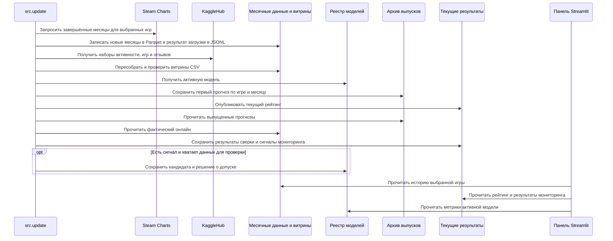

# 🎮 Steam Popularity Forecast

Прогнозно-аналитическая система оценки и прогнозирования популярности компьютерных игр Steam.

**Что прогнозируем:** среднее число одновременно играющих пользователей в следующем месяце.

**Для кого:** для аналитика, который отслеживает рост и спад активности по играм.

## 🎯 Что можно увидеть на панели

- **Ожидаемый рост и спад.** Игры можно отсортировать по прогнозируемому изменению онлайна. Изменение показано в игроках и процентах.
- **История выбранной игры.** График показывает средний и пиковый онлайн. У игр из свежего выпуска пунктиром отмечен прогноз на следующий месяц. Для архивных игр указана дата последнего наблюдения.
- **Результаты прошлых выпусков.** Когда появляется фактический онлайн, панель показывает ошибку и отмечает, совпало ли направление изменения.

## 📅 Как проходит месячный выпуск



Steam Charts даёт свежие месячные наблюдения. Архивы Kaggle дополняют их историей
активности, характеристиками игр и текстами отзывов. Из витрины рассчитываются лаги,
скользящие средние, отношение пика к среднему онлайну, изменение активности
и признаки отзывов.

| Файлы | Что в них хранится |
|---|---|
| `data/raw/steam_charts_monthly/` | Месячная история в Parquet, по одному файлу на игру |
| `data/raw/steam_charts_loads.jsonl` | Результат каждой загрузки по игре |
| `data/processed/` | Полная и обучающая витрины CSV |
| `artifacts/model_registry/` | Версии моделей, признаки, параметры и метрики |
| `artifacts/latest_forecasts.csv` | Текущий выпуск для рейтинга на панели |
| `artifacts/forecast_history/` | Выпущенные прогнозы по месяцам |
| `artifacts/forecast_monitoring.csv` | Результат сверки каждого выпуска с фактом |
| `artifacts/forecast_quality.json` | Сигналы качества и сдвига признаков |

## 🧪 Как выбирается и меняется модель

Сравниваются три метода: перенос последнего онлайна, регрессия по ближайшим
соседям и случайный лес. Для каждого окна 2018, 2019 и 2020 годов используются
только более ранние данные обучения. Модель выбирается по средней MAE по играм.
На отдельном тесте за январь–сентябрь 2021 года считаются MAE, RMSE и доля
верно предсказанных направлений.

При обновлении система использует активную версию из реестра. Сигнал
переобучения возникает при сдвиге входных признаков или если активная
модель три месяца подряд ошибается более чем на 10% сильнее базового
прогноза. Кандидат проходит допуск, если на трёх проверочных месяцах
снижает MAE по играм минимум на 5% относительно активной модели и его
ошибка не превышает базовую. В каждом проверочном месяце нужен факт
хотя бы по трём играм.

## ▶️ Как открыть свой выпуск

Из корня проекта в PowerShell выполни:

```powershell
python -m venv .venv
.\.venv\Scripts\python.exe -m pip install -r requirements.txt
.\.venv\Scripts\python.exe -m src.update
.\.venv\Scripts\python.exe -m streamlit run src/dashboard/app.py --server.address 127.0.0.1
```

Для обновления нужен доступ к Kaggle и Steam Charts. При первом запуске
создаются витрины, реестр и первый выпуск. По умолчанию Steam Charts
обновляется для CS2, Dota 2 и PUBG. Список можно задать переменной
`PAS_APPIDS`, например `730,570,578080`, или передать в команду:

```powershell
.\.venv\Scripts\python.exe -m src.update 730 570 578080
```

Панель перечитывает результаты каждые 30 секунд. Свежий рейтинг включает
игры с данными за общий последний месяц. Остальные доступны в списке
выбора как архивные.

## 🔁 Как проверить мониторинг и управление версиями

```powershell
.\.venv\Scripts\python.exe -m src.modeling.monitor_forecasts --demo
.\.venv\Scripts\python.exe -m src.modeling.retrain_model --demo
.\.venv\Scripts\python.exe -m src.modeling.feature_comparison
.\.venv\Scripts\python.exe -m src.modeling.simulate_degradation
.\.venv\Scripts\python.exe -m unittest discover -s tests -p test_model_registry.py
```

Первый сценарий сверяет исторические прогнозы с фактом, второй проверяет
допуск кандидата. Для активации допущенной версии используется
`python -m src.modeling.manage_model --activate ID`, для возврата
к предыдущей — `python -m src.modeling.manage_model --rollback`.