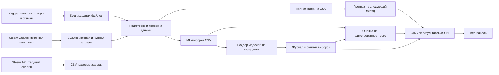

# 🎮 Steam Popularity Forecast

Прогнозно-аналитическая система для анализа и прогнозирования популярности компьютерных игр на платформе **Steam**.

## 📌 Постановка задачи

**Тема проекта:**  
Разработка прогнозно-аналитической системы оценки и прогнозирования популярности компьютерных игр.

**Прогнозируемый показатель:**  
Среднее количество активных игроков компьютерной игры в следующем месяце.

**Практическая задача:**  
Анализ динамики популярности компьютерных игр и прогнозирование изменения интереса пользователей к ним.

**Пользователь системы:**  
Аналитик игровой индустрии, которому необходимо отслеживать динамику популярности компьютерных игр и получать прогнозы изменения пользовательской активности.

## 📊 Источники данных

- **Steam Player Data** — исторические данные о среднем и пиковом количестве активных игроков.
- **Steam Games Dataset** — характеристики компьютерных игр.
- **Steam Reviews Dataset** — пользовательские отзывы об играх.
- **Steam API** — получение актуального количества активных игроков.

## 🧩 Архитектура системы

- **Хранение** — исходные файлы в кэше KaggleHub, месячная история и журнал загрузок в SQLite, витрины и результаты в CSV.
- **Обработка** — очистка, объединение источников и расчёт признаков в pandas.
- **Модели** — базовый прогноз, Ridge и случайный лес. Обучение ML-моделей выполняется в scikit-learn.
- **Визуализация** — локальная веб-панель с рейтингом игр, графиком факта и прогноза, тестовыми метриками и журналом экспериментов.

## 📈 Сравнение моделей

**Периоды:** обучение — до 2020 года, валидация — 2020 год, тест — январь–сентябрь 2021 года. Разбиение выполняется по месяцу, который прогнозируется.

**Подбор:** для Ridge и случайного леса проверяются разные гиперпараметры и варианты с текстовыми признаками отзывов. Лучшие конфигурации выбираются по MAE на валидации, затем обучаются на объединённых данных обучения и валидации. На фиксированном тесте методы сравниваются по MAE и RMSE.

**Рабочий прогноз:** используется базовый метод, у которого была наименьшая MAE на валидации. Он переносит средний онлайн последнего месяца на следующий. В свежий рейтинг входят игры с наблюдением за общий последний месяц. Разовые замеры Steam API хранятся отдельно.